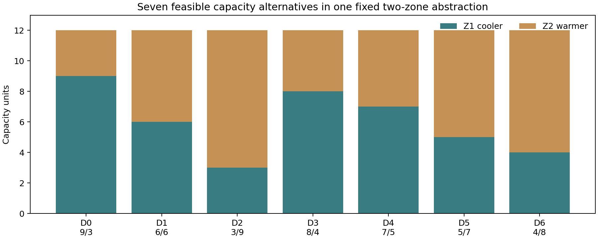
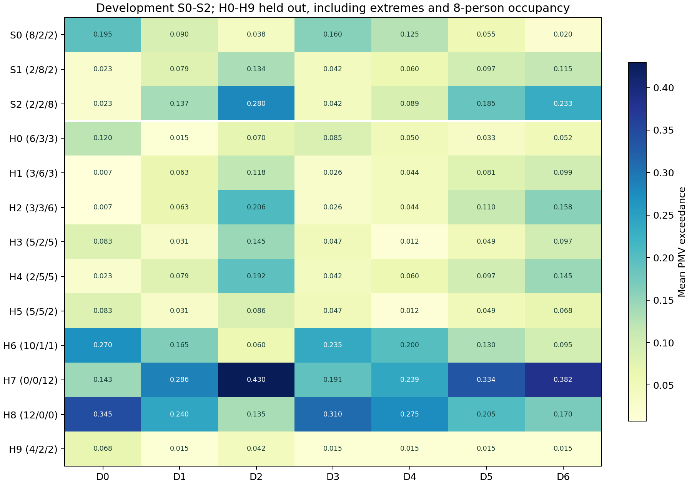
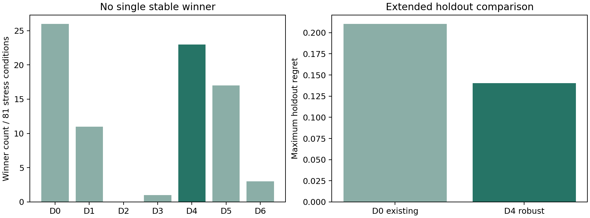

# ARCH7476 · Assignment 03
# Thermal-zone capacity under changing user composition

**PeopleComfort v0.2.0 | Revised workflow prototype | 18 November 2026**

## Four-line research summary

| Item | Finding |
|---|---|
| Decision | Should a fixed 12-place shared room retain the existing 9/3 cooler/warmer capacity split (D0), or change the split before the future user mix is known? |
| Core result | Across all seven feasible 12-place splits, minimax regret selects 7/5 (D4). Its maximum regret over the ten holdouts is 0.1403 versus D0's 0.2105: a 33.3% reduction in the model objective. The earlier three-candidate result that selected 6/6 (D1) does not survive candidate expansion. |
| Greatest uncertainty | The thermal inputs and user mixes are hypothetical; 7/5 wins only 23 of 81 joint stress conditions, and ideal managed assignment has not been observed. |
| Design action | Retain D0 pending site evidence. An explicitly exploratory action gate requires both at least 20% holdout improvement and non-inferiority to D0 in at least 75% of stress conditions; the second check reaches only 54/81 (66.7%). |

## Research background and question

Shared interiors can contain different thermal regions while users differ in activity and clothing. A spatial design fixes how many people may use each region, whereas the eventual composition can change. Existing work studies spatial thermal preference [1], cubicle assignment under personal preferences [2], personal-comfort-model space matching [3], and seat recommendations coupled with HVAC control [4]. The narrower question here is whether a *physical capacity distribution*, selected before the user mix is known, remains useful across several mixes. The work compares a frozen design, not just one day's assignment.

**Research question.** Which two-zone capacity split minimizes the maximum opportunity loss across three development compositions, and how does that frozen split perform against the existing 9/3 split on holdout compositions, an alternate comfort metric and joint input perturbations?

The method separates zone definition, thermal calculation, feasible allocation and decision comparison. The starting inputs are a transparent hypothetical stress case. There is no surveyed floor plan, measured thermal field or observed occupant sample. The PMV and PPD numbers are calculated with a formula from the stated six-factor inputs; they are not arbitrary pre-filled suitability ratings. A site-specific recommendation would require measured or credibly simulated zone conditions, capacity and use records.

## 1. Prototype Scope

**Decision and controlled alternatives.** One schematic room has a cooler zone Z1 and warmer zone Z2, each with physical maximum capacity nine. Twelve equal capacity units are distributed between them. D0 is the stated existing reference, not historical evidence of an actual room. All seven feasible integer splits with Z1 capacity 3-9 are included. The physical intervention is capacity; the second-stage user placement is a common operating assumption.



| Design | Z1 / Z2 places | Role |
|---|---:|---|
| D0 | 9 / 3 | Existing reference within the analytical case |
| D3 | 8 / 4 | Added candidate |
| D4 | 7 / 5 | Added candidate; nominal robust winner |
| D1 | 6 / 6 | Original balanced candidate |
| D5 | 5 / 7 | Added candidate |
| D6 | 4 / 8 | Added candidate; S0-only winner |
| D2 | 3 / 9 | Original warmer-zone candidate |

**Inputs and evidence status.** Z1 uses Ta=23.5°C, MRT=23.5°C, RH=50% and air speed=0.1 m/s. Z2 uses Ta=27.5°C, MRT=27.5°C, RH=50% and air speed=0.1 m/s. P1 is 1.0 met/0.5 clo, P2 is 1.2 met/0.5 clo, and P3 is 1.2 met/0.8 clo. These profiles describe activity and clothing, not age or demographic categories. The four-degree zone contrast deliberately stresses the decision. Related library research examines zone control and measured thermal conditions [8], but it does **not** validate these exact two values or their simultaneous occurrence in this room. Source labels in the JSON explicitly say that these inputs are hypothetical.

**Scenario range.** S0=8/2/2, S1=2/8/2 and S2=2/2/8 are development mixes, in P1/P2/P3 order. H0-H5 are the original six interior holdouts. H6=10/1/1, H7=0/0/12 and H8=12/0/0 probe mixes outside the development envelope. H9=4/2/2 has eight users and twelve available places, testing partial occupancy. All ten holdouts are excluded from design selection. The three extremes are deliberately constructed tests; they are not forecasts.

**Workflow route and output.** The rerunnable Python package calls pinned CBE thermal code, enumerates every feasible two-zone integer allocation, evaluates all 7×13=91 design-composition cells, computes three selection rules, and perturbs four thermal/screening assumptions jointly over 81 conditions. The browser page exposes the thermal inputs and recalculates PMV with the same pinned CBE JavaScript. Output includes full JSON, CSV, thermal ledger and three explanatory figures.

**Scope boundary.** No plan geometry, HVAC feedback, furniture feasibility, actual seat choice, temporal adaptation, energy cost or individual thermal vote is inferred. PMV is a group-average model evaluated for declared met/clo configurations; the profile labels do not turn it into an individual prediction.

## 1.1 Hypothesis and rival explanations

The original three-option pilot suggested 6/6 would be robust. Expanding the candidate set provides a direct challenge to that result. The revised hypothesis is narrower: a minimax-regret split can reduce maximum holdout opportunity loss relative to the existing 9/3 split under the declared model. Its rival explanations include candidate-set geometry, a threshold effect near P1's +0.530 PMV in Z2, extreme compositions, empty capacity at eight-person occupancy, and optimistic managed assignment. The tests below expose several of these dependencies rather than claiming a universal split.

## 2. Workflow Artifact and reproducibility

The public repository contains the engine, pinned CBE JavaScript and GPL-2.0 notice, both project JSON files, analysis script, independent PMV-check script, outputs and tests. Python 3.11+ and Node.js 18+ are required for the main workflow; this run used Python 3.12.12 and Node v24.11.1. The independent library is a verification dependency only.

```console
python -m pip install -e .
python -m unittest discover -s tests -v
python coursework/analyze_extended.py
python run.py analyze --project examples/extended-a3/project.json --out rerun-extended
python -m pip install -r verification/requirements.txt
python verification/independent_pmv_check.py
python coursework/build_pdf.py
```

`examples/extended-a3/project.json` drives the seven-design analysis and 81-condition stress grid. `examples/a3-thermal/project.json` expresses the same nominal decision in schema v2 for the public browser editor. `coursework/extended_matrix.csv`, `extended_results.json` and the figures can be regenerated. The independent verification compares the pinned CBE engine with pythermalcomfort 4.8.1. The PDF is generated from this Markdown source. A screenshot is supplementary to these runnable artifacts.

**Isolated installation check.** A wheel was built, installed into a newly created Python virtual environment, and its `peoplecomfort analyze` command was run from outside the source checkout against `examples/a3-thermal/project.json`. It produced 91 rows and selected D4; the installed package contained the CBE source and browser assets. The temporary virtual environment is not part of the submission.

| Artifact | Reproducibility role |
|---|---|
| `src/peoplecomfort/`, `run.py`, `pyproject.toml` | Validated engine, browser, CLI, pinned CBE implementation |
| `examples/extended-a3/project.json` | All seven candidates, thirteen compositions, four stress dimensions and action-rule status |
| `examples/a3-thermal/project.json` | Equivalent nominal inputs in the general schema used by the browser |
| `coursework/analyze_extended.py`, `extended_results.json`, `extended_matrix.csv` | Rebuild and inspect the revised comparisons |
| `verification/independent_pmv_check.py`, `independent_pmv_comparison.json` | Reproduce six-case cross-implementation PMV/PPD check |
| `tests/` | Capacity, assignment, split, partial occupancy and PMV integration tests |

## 3. Workflow Description

| Input | Operation | Output | Quality check | Design interpretation |
|---|---|---|---|---|
| Zone conditions, met/clo profiles and source statements | Validate six-factor bounds and calculate CBE PMV/PPD | Six profile-zone thermal records | Compare six nominal cases with independent pythermalcomfort; inspect input provenance | Identify modelled thermal opportunities, conditional on input quality |
| Seven splits and 13 explicit mixes | Enumerate full feasible integer assignments; minimize mean PMV exceedance | 91 losses, assignments and group burdens | Conserve occupied people, enforce capacities/access, reject infeasible rows | Compare available capacity under identical thermal fields |
| S0-S2 development rows | Minimize baseline loss, worst loss and maximum regret | Frozen candidate selections | Keep H0-H9 outside selection; preserve ties | Choose a physical split under uncertain composition |
| H0-H9 | Compute regret for frozen designs; repeat using mean PPD | Holdout and alternate-metric checks | Show outside-envelope and eight-person rows separately | Test transfer and threshold dependence |
| 81 joint input conditions | Recalculate PMV, allocation and selection | Winner counts and D0/D4 comparison | Treat counts as grid coverage, not probabilities | Decide whether a nominal recommendation survives perturbation |

## 4. Generative Loop and method rationale

| Loop step | Declared implementation |
|---|---|
| 1. Input condition | One two-zone abstraction; twelve available places; CBE PMV inputs and access constraints |
| 2. Variable / range | Z1 capacity 3-9, with Z2=12-Z1; 3 development mixes; 10 holdouts, one at 8/12 occupancy |
| 3. Variants | D0, D3, D4, D1, D5, D6 and D2, covering all seven feasible splits |
| 4. Evaluation metric | Mean exceedance `max(0, |PMV|-0.5)` per occupied person; report mean PPD in parallel |
| 5. Output | Full 91-cell matrix, allocations, PMV/PPD ledger, regrets and 81-condition stress record |
| 6. Comparison rule | S0-only minimum versus maximum development regret; compare selected design with D0 on frozen holdouts and stress grid |
| 7. Design action | Apply the explicit exploratory gate below; if it fails, retain D0 pending field evidence |

For type *i* in zone *z*, `e(i,z)=max(0,abs(PMV(i,z))-0.5)`. The design/scenario loss is `sum assigned_count(i,z)*e(i,z) / occupied_people`. Thus H9 is divided by eight, not twelve. Regret in scenario *s* is the design's loss minus the lowest feasible candidate loss in *s*. The algorithm enumerates all integer allocations to two zones, with capacity, full assignment and allowed-zone constraints. Equal first-stage capacity controls resource count; empty seats are permitted at partial occupancy. The model assumes a manager can implement the allocation. It does not predict voluntary movement.

**Decision threshold status.** No auditable record proves that the pilot's 20% threshold was frozen before its first holdout calculation. It must therefore be treated as post hoc. The revised action gate (at least 20% holdout improvement versus D0, plus D4 no worse than D0 by more than 0.01 regret in at least 75% of the 81 stress conditions) is also explicitly exploratory and was formulated during this revision. It is a transparent decision rule for this exercise, not a preregistered confirmatory test. A field study must date and freeze its gate before collecting or inspecting holdout outcomes.

## 5. Prototype Output and design interpretation

The expanded candidate set changes the recommendation. S0-only selection is D6 (4/8); minimax development regret is D4 (7/5). The old 6/6 result was contingent on restricting the candidates to D0-D2. The full matrix includes three development, six interior holdout, three outside-envelope holdout and one eight-person holdout compositions.



| Design | S0 loss | Development max regret | Ten-holdout max regret | Stress-grid wins / 81 |
|---|---:|---:|---:|---:|
| D0 9/3 | 0.1953 | 0.1754 | 0.2105 | 26 |
| D3 8/4 | 0.1602 | 0.1403 | 0.1754 | 1 |
| D4 7/5 | 0.1251 | **0.1052** | **0.1403** | 23 |
| D1 6/6 | 0.0900 | 0.1139 | 0.1432 | 11 |
| D5 5/7 | 0.0549 | 0.1616 | 0.1910 | 17 |
| D6 4/8 | **0.0199** | 0.2094 | 0.2387 | 3 |
| D2 3/9 | 0.0383 | 0.2571 | 0.2864 | 0 |

The headline comparison is D4 versus the existing D0: `(0.2105-0.1403)/0.2105 = 33.3%` lower maximum holdout regret. This is a reduction in *model opportunity loss*, not observed satisfaction. In the original restricted three-candidate pilot, D1 versus D0 reduced six-holdout maximum regret from 0.1052 to 0.0552 (about 47.5%). The former 72.19% headline compared D1 with the S0-only D2 and is not the relevant existing-design comparison. Candidate expansion changes all regret benchmarks, so the old and revised percentages must not be treated as the same experiment.

The extreme holdouts reveal asymmetry. H6=10/1/1 gives D0 loss 0.2704 and D1 loss 0.1651; H7=0/0/12 gives D0 0.1432 and D1 0.2864; H8=12/0/0 gives D0 0.3455 and D1 0.2403. H9=4/2/2 uses eight people and twelve available places, giving D0 0.0675 and D1 0.0149. This is a structural test of spare capacity, not evidence of actual occupancy probabilities.

**Alternate continuous check.** Re-optimizing allocation on *mean CBE PPD* selects D4 on both development and extended holdout maximum-regret criteria. Development PPD-regret is 3.3051 percentage points for D4 versus 5.5084 for D0; holdout PPD-regret is 4.4067 versus 6.6101. This agreement reduces concern that the nominal ranking is solely an artifact of the ±0.5 PMV screening edge, but PPD is derived from the same PMV model and is not independent occupant feedback.



## 6. Verification and Failure Log

### 6.1 What worked and what was checked

The six nominal CBE outputs were independently recomputed with pythermalcomfort 4.8.1 `pmv_ppd_ashrae`, using its relative-air-speed helper, zero external work and unrounded output [7]. Across the six cases, maximum absolute PMV difference was 0.001497 and maximum PPD difference was 0.0458 percentage points. This checks an independently maintained implementation of the same model, not field accuracy. Twelve additional comparisons with the public CBE deployment remain integration checks because the source ancestry is shared. The assignment solver is separately checked against a person-level brute-force oracle; automated tests cover invalid inputs, holdout separation and partial occupancy. The browser's default thermal ledger and nominal winner were compared with Python results.

### 6.2 Substantive failure and revision record

| Observation or failure | Check performed | Revision and consequence |
|---|---|---|
| The original 6/6 D1 choice looked robust among only three symmetric alternatives. | Enumerated every feasible 12-place split from 3/9 through 9/3. | D4 7/5 becomes the minimax-regret winner. The earlier D1 headline is withdrawn as a candidate-set-dependent finding. |
| The earlier six holdouts lay inside the development envelope. | Added 10/1/1, 0/0/12 and 12/0/0 outside-envelope compositions, plus 4/2/2 at eight-person occupancy. | Maximum holdout regret increases; extreme mixes sometimes favour opposite capacity directions. Transfer remains a finite constructed test. |
| Full occupancy forced all twelve places into use. | Enabled explicitly declared partial occupancy and checked an eight-person allocation ledger. | Empty capacity changes loss; the denominator is occupied people. The original schema still rejects partial occupancy without opt-in. |
| PMV exceedance may be sensitive to P1's Z2 PMV near +0.5. | Recomputed assignments and regret using continuous PPD. | D4 remains nominal winner under PPD, but PPD shares the PMV model and cannot validate lived experience. |
| A nominal D4 win might invite an unconditional redesign claim. | Recomputed selection across 81 joint temperature, clothing and threshold conditions. | D4 wins 23/81; D0 wins 26/81. D4 is within 0.01 regret of D0 in only 54/81 (66.7%), below the exploratory 75% action gate. Retain D0 pending site evidence. |
| Shared CBE code produced near-exact agreement with its own deployment. | Added pythermalcomfort as a separate implementation and recorded six-case signed differences. | Numerical confidence is stronger but empirical validity is still untested. |
| The starting temperatures had no site provenance. | Audited source fields and reviewed library thermal-zoning literature. | Values are now explicitly labelled a hypothetical contrast, not a representative measured room; no field-design claim follows. |

### 6.3 Uncertainty and design action

The 81-condition grid combines common Ta/MRT offsets of -0.5/0/+0.5°C, opposing zone offsets of -0.5/0/+0.5°C, clothing offsets of -0.1/0/+0.1 clo and screening thresholds 0.4/0.5/0.6. These are equal-weighted grid points for diagnosis, not probabilities or calibrated instrument errors. D0 wins 26, D4 wins 23, D5 wins 17, D1 wins 11, D6 wins 3 and D3 wins 1 condition. D2 wins none. D4 has lower nominal holdout maximum regret than D0 by 33.3%, so the first exploratory gate passes. The second fails at 54/81 versus the required 61/81 or more. **Action: retain D0 as the provisional reference, collect real plan, thermal and use evidence, then freeze and rerun the decision rule.** This does not establish that D0 is comfortable or preferable in a real building.

What remains untrusted: actual zone temperatures and radiant conditions, valid met/clo profiles for occupants, accessible/usable capacity, the behavioural plausibility of managed allocation, the omission of energy and construction cost, and the model's relation to observed thermal votes. A real A4 study should register the candidate set and gate, measure local conditions over relevant periods, map capacity and accessibility from a plan, observe occupancy and moves, record occupant votes, and compare predicted versus observed outcomes.

## 7. AI-Assisted Fact-Checking Card

| AI-assisted claim or output | Evidence and manual check | Verdict | Action |
|---|---|---|---|
| "6/6 is the robust spatial design" | Original three-candidate analysis; seven-candidate rerun selects 7/5. | **Reject** as a general claim | Replace with candidate-set-specific result; report D4 for the expanded set. |
| "Pinned CBE PMV is numerically integrated correctly" | Six pythermalcomfort cross-checks: max PMV difference 0.001497; 12 same-source deployment cases; inspect all six-factor inputs. | **Accept**, limited to numerical integration | Preserve case ledger and version pins; do not infer field accuracy. |
| "D4 reduces regret relative to D0" | Inspect ten-holdout maximum regrets 0.1403 and 0.2105; recompute ratio from unrounded JSON. | **Accept** for the hypothetical model | State 33.3% model improvement and its exact comparison. |
| "D4 should replace D0 in a real shared room" | No surveyed plan, measured thermal field, occupancy observations or pre-registered rule; stress gate fails. | **Reject** | Retain D0 pending site evidence and a prospective field decision. |
| "The 20% threshold was prespecified" | No timestamped or committed preregistration before the original holdout result. | **Reject** | Mark both the earlier threshold and revised action gate post hoc exploratory. |
| "The temperature contrast represents a typical reading room" | No source supports this exact simultaneous 23.5/27.5°C pair at this site. | **Pending** | Use measured or validated local inputs before claiming representativeness. |

AI assisted code, page and report drafting. The fact-checking verdicts were made against actual generated outputs and cited source records. The card is an audit of claims, not proof that the thermal model predicts any individual. `verification/independent_pmv_comparison.json`, the project JSON and `coursework/extended_results.json` preserve the checks.

## 8. A4 extension

The next study should apply the workflow to one documented design decision with an actual plan. Survey or model zone conditions at relevant times, verify accessible and usable capacity, document occupancy mixes, and ask users for thermal votes. Freeze the design alternatives, outcome metrics and action gate before evaluating holdouts. Compare ideal assignment with observed choice and account for any management effort. Add buildability and resource cost if the number of places or HVAC conditions differ. Until these steps are complete, the prototype supports an inspectable *method*, not a site-specific redesign.

## References

1. Shahzad, S., Calautit, J.K., Hughes, B.R., et al. (2019). Patterns of thermal preference and Visual Thermal Landscaping model in the workplace. *Applied Energy* 255, 113674. https://doi.org/10.1016/j.apenergy.2019.113674
2. Lei, S. and Shen, W. (2021). Optimal Open Space Cubicle Assignment Considering Personal Thermal Preferences. *2021 IEEE CSCWD*, 913-918. https://doi.org/10.1109/CSCWD49262.2021.9437617
3. Huang, W., Xu, Q., Zhao, B., Lv, Q. and Wang, G. (2025). Space-matching strategies based on personal comfort models to optimize collective comfort probability. *Building and Environment*, 112819. https://doi.org/10.1016/j.buildenv.2025.112819
4. Kamiya, Y., Zhang, R., Kanayama, H., Sato, D., Matsui, N., Taniguchi, K. and Akashi, Y. (2024). Human-centric Air Conditioning System with Seat Changes: Control Logic Combining Seat Change Recommendations and Air Conditioning Control. *ASim 2024*, 316-323. https://doi.org/10.69357/asim2024.1308
5. Center for the Built Environment, University of California, Berkeley. PMV Model documentation and pinned `comfort_tool` source. https://cbe-berkeley.gitbook.io/thermal-comfort-tool/documentation/pmv ; https://github.com/CenterForTheBuiltEnvironment/comfort_tool
6. ARCH7476. Assignment 03 and Assignment 04. https://caadfutures2025.hku.hk/ARCH7476/assignments/assignment-03.html ; https://caadfutures2025.hku.hk/ARCH7476/assignments/assignment-04.html
7. pythermalcomfort maintainers (2026). `pmv_ppd_ashrae` model documentation, version 4.8.1. https://pythermalcomfort.readthedocs.io/en/stable/documentation/models.html
8. Wang, H., Zhang, F., Li, J., Meng, H. and Lin, H. (2024). Effects of different zoning thermostat controls on thermal comfort and cooling energy consumption in reading rooms of a library. *Energy* 292, 130507. https://doi.org/10.1016/j.energy.2024.130507
